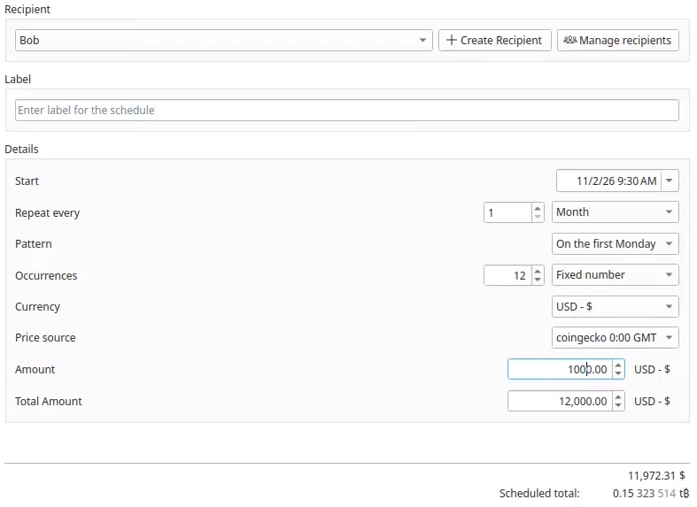
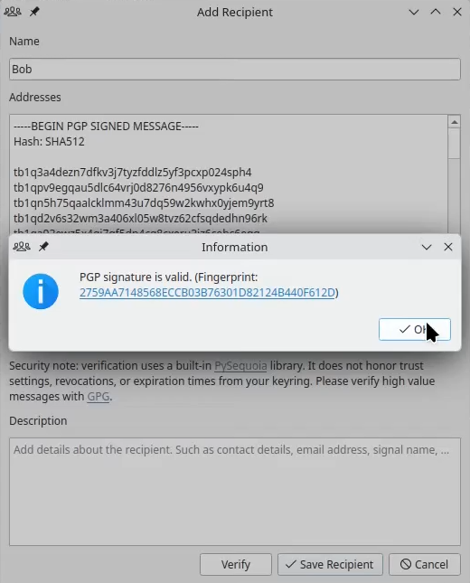
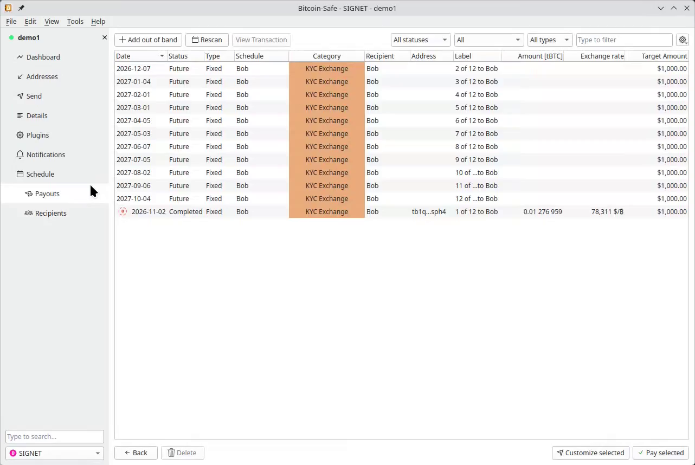

---
aliases:
  - "/plugins/schedule/"
title: "Schedule"
description: "Plan one-time or recurring Bitcoin payments, track when they are due, and prepare transactions for review in Bitcoin-Safe."
draft: false
tags: ["Plugins"]
images: ["schedule.png"]
weight: 40
faq:
  title: "Scheduled Payments questions"
  items:
    - question: "Can I schedule a single payment or only recurring ones?"
      answer: "Both. You can create a one-time payment, a fixed number of repeats, or an ongoing schedule."
    - question: "How often can a schedule repeat?"
      answer: "Repeat intervals are available as:\n- Minutes, hours, or days\n- Weeks, optionally on selected weekdays\n- Months or years, on calendar dates or weekday patterns"
    - question: "Can I set the amount in fiat?"
      answer: "Yes. You can set the amount in:\n- Bitcoin\n- A supported fiat currency\n\nFiat amounts can use either:\n- A live exchange rate\n- The CoinGecko rate, fixed at 00:00 GMT\n\nAn exchange-rate override can also be set for the next payment."
    - question: "Are addresses reused?"
      answer: "No. Each recipient address is used only once. When a recipient's addresses run out, you can add more addresses for that recipient."
    - question: "Does Bitcoin-Safe send the payments automatically?"
      answer: "No. When a payment is due, Schedule prepares the transaction in Bitcoin-Safe for your review, and you remain responsible for signing and broadcasting it."
    - question: "Can I pay multiple recipients at once?"
      answer: "Yes. Select several scheduled payments and click **Pay selected**. Bitcoin-Safe combines them into one batch transaction."
    - question: "What if a payment was already made in cash or another way?"
      answer: "Add an **out of band** payout. It records the payment in your schedule without a Bitcoin transaction, so the progress stays accurate."

---

### 

Plan Bitcoin payments and let Schedule keep track of what is due.

<ul class="plugin-features">
<li>Pay employees or organize other regular obligations</li>
<li>Set up recurring transfers</li>
<li>Schedule a one-time payment you must not forget</li>
</ul>

When a payment is due, Schedule prepares the transaction in Bitcoin-Safe for your review. You remain responsible for signing and broadcasting it.



### 1. Create a schedule

{ .img-fluid }

- 🗓️ Create a one-time payment, a fixed number of repeats, or an ongoing schedule.
- 🔁 Choose a start date and repeat as often as minutes, hours, days, weeks, months, or years. Set specific weekdays or calendar dates for weekly, monthly, and yearly schedules.
- 💱 Set an amount in bitcoin or a supported fiat currency. Choose a live exchange rate, the CoinGecko rate from 00:00 GMT, or enter a custom rate before creating the payout.
- 🧮 Preview per-payment and total amounts for schedules with a fixed number of payments.

### 2. Add a recipient

{ .img-fluid }

- 👤 Save recipient details and organize multiple payout addresses under one recipient.
- 📬 Add addresses directly or use a PGP-signed message.
- 🔐 Each address is used only once. Add more addresses to a recipient whenever needed.

### 3. Create transactions and review payouts

{ .img-fluid }

- ⚡ Create a transaction for one due payment, or select payouts to different recipients and combine them into one batch.
- ✅ Review and customize each transaction in Bitcoin-Safe, then sign and broadcast it yourself. Schedule never sends bitcoin automatically.
- 📊 See completed payouts, upcoming payments, and schedule progress in one place.
- 🧾 Record a payout manually (Add out-of-band) if it was already made outside Bitcoin, such as in fiat, without creating a Bitcoin transaction.
- 📤 Export all schedule and payout data to CSV.



<section class="plugin-cta-band border rounded-4 bg-body-tertiary p-4 mt-5 text-center">
<h2 class="h4 mb-2">Get Bitcoin-Safe</h2>

Plugins ship with Bitcoin-Safe. Download the app to try them.

<a class="btn btn-primary px-4" href="../../download/">Download Bitcoin-Safe</a>
<small class="text-muted">Free &amp; open source · Windows, macOS, Linux</small>

</section>

### Frequently asked questions

Can I schedule a single payment or only recurring ones?

Both. You can create a one-time payment, a fixed number of repeats, or an ongoing schedule.

How often can a schedule repeat?

Repeat intervals are available as:

- Minutes, hours, or days
- Weeks, optionally on selected weekdays
- Months or years, on calendar dates or weekday patterns

Can I set the amount in fiat?

Yes. You can set the amount in:

- Bitcoin
- A supported fiat currency

Fiat amounts can use either:

- A live exchange rate
- The CoinGecko rate, fixed at 00:00 GMT

An exchange-rate override can also be set for the next payment.

Are addresses reused?

No. Each recipient address is used only once. When a recipient's addresses run out, you can add more addresses for that recipient.

Does Bitcoin-Safe send the payments automatically?

No. When a payment is due, Schedule prepares the transaction in Bitcoin-Safe for your review, and you remain responsible for signing and broadcasting it.

Can I pay multiple recipients at once?

Yes. Select several scheduled payments and click **Pay selected**. Bitcoin-Safe combines them into one batch transaction.

What if a payment was already made in cash or another way?

Add an **out of band** payout. It records the payment in your schedule without a Bitcoin transaction, so the progress stays accurate.

